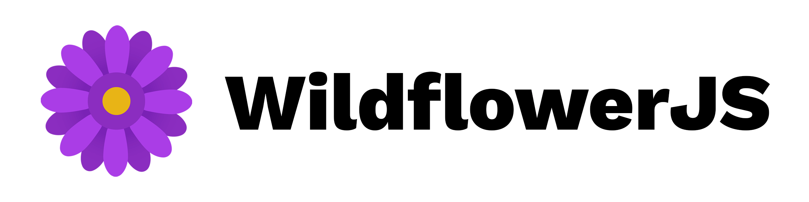

<a href="https://www.wildflowerjs.com">
  <picture>
    <source media="(prefers-color-scheme: dark)" srcset="assets/readme-banner-dark.png">
    
  </picture>
</a>

**Reactive JS, No BS.** A no-build reactive JavaScript framework as fast and robust as compiled frameworks.

[](https://www.npmjs.com/package/wildflowerjs)
[](https://github.com/wfjs-admin/WildflowerJS/blob/main/LICENSE)
[](https://bundlephobia.com/package/wildflowerjs)
[](https://github.com/wfjs-admin/WildflowerJS/actions/workflows/ci.yml)

You write 100% standard HTML, JavaScript, and CSS.
`data-*` attributes in the HTML say which state an element shows and which method an event calls, and the framework updates the DOM directly when that state changes.
There is no build step, virtual DOM, or template syntax to learn.
One script tag loads it, and the npm package is optional.

**[Documentation](https://www.wildflowerjs.com)** | **[Quick Start](https://www.wildflowerjs.com/getting-started/quickstart/)** | **[Demos](https://www.wildflowerjs.com/demos/)** | **[Patterns](https://www.wildflowerjs.com/patterns/)** | **[Changelog](https://www.wildflowerjs.com/changelog.html)**

## Quick Start

Save this as an `.html` file and open it in a browser.

```html
<!DOCTYPE html>
<html>
<head>
    <meta charset="UTF-8">
    <title>Counter</title>
    <script src="https://cdn.jsdelivr.net/npm/wildflowerjs@1/dist/wildflower.min.js"></script>
</head>
<body>
    <div data-component="counter">
        <h1 data-bind="count"></h1>
        <button data-action="increment">+1</button>
    </div>

    <script>
        wildflower.component('counter', {
            state: { count: 0 },
            increment() {
                this.count++;
            }
        });
    </script>
</body>
</html>
```

`data-component` marks the element the `counter` component controls.
`data-bind="count"` shows `count` in the heading, and `data-action="increment"` calls `increment()` on a click.
Changing `this.count` updates the heading.

This page keeps its code in an inline script, so the framework tag has no `defer`.
A page that keeps its code in a separate file loads the framework and that file with `defer`:

```html
<script defer src="https://cdn.jsdelivr.net/npm/wildflowerjs@1/dist/wildflower.min.js"></script>
<script defer src="app.js"></script>
```

`wildflowerjs@1` always loads the newest 1.x release.
Pin an exact version, such as `wildflowerjs@1.5.8`, for production.

To install it from npm instead:

```bash
npm install wildflowerjs
```

Each tier is also built as an ES module, and importing one registers the same `wildflower` global:

```js
import wildflower from 'wildflowerjs';         // the core tier
import wildflower from 'wildflowerjs/full';    // or nano, mini-pool, mini, lite, spa
```

## A Larger Example

A store holds state that more than one component uses.
Here a task list and a count in the page header read the same store.
The markup and the script replace the counter in the page above.

```html
<header data-component="task-count">
    <strong data-bind="$tasks.remaining"></strong> to do
</header>

<main data-component="task-list">
    <form data-action="submit:add" data-event-prevent>
        <input data-model="draft" placeholder="Add a task">
        <button>Add</button>
    </form>

    <ul data-list="$tasks.items" data-key="id">
        <template>
            <li>
                <span data-bind="text" data-bind-class="done ? 'done' : ''"></span>
                <button data-action="toggle">Done</button>
                <button data-action="remove">Remove</button>
            </li>
        </template>
    </ul>
</main>
```

```js
wildflower.store('tasks', {
    state: { items: [], nextId: 1 },
    computed: {
        remaining() {
            return this.items.filter(task => !task.done).length;
        }
    },
    add(text) {
        this.items.push({ id: this.nextId++, text, done: false });
    },
    toggle(id) {
        const task = this.items.find(task => task.id === id);
        task.done = !task.done;
    },
    remove(id) {
        this.items = this.items.filter(task => task.id !== id);
    }
});

wildflower.component('task-count', {});

wildflower.component('task-list', {
    state: { draft: '' },
    add() {
        const text = this.draft.trim();
        if (!text) return;
        wildflower.getStore('tasks').add(text);
        this.draft = '';
    },
    toggle(event, element, details) {
        wildflower.getStore('tasks').toggle(details.item.id);
    },
    remove(event, element, details) {
        wildflower.getStore('tasks').remove(details.item.id);
    }
});
```

`data-model` ties the input to `draft` in both directions.
`data-list` renders its `<template>` once for each item, and a binding inside the template reads that item's fields.
`$tasks` reads the store from the HTML, and `remaining` is recalculated when an item is added, finished, or removed.
An action inside a list receives the item of the row it came from as `details.item`.

## How It Works

- **The page's HTML is the template.** Attributes say which state an element shows ([`data-bind`, `data-show`, `data-render`, `data-list`](https://www.wildflowerjs.com/docs/binding/)), which state it changes (`data-model`), and which method an event calls ([`data-action`](https://www.wildflowerjs.com/docs/events/)).
- **State is a plain object.** Assign to a field and every element bound to it updates. Nested objects and arrays are reactive too, so a path such as `order.customer.name` can be bound and assigned. See [Reactivity](https://www.wildflowerjs.com/docs/reactivity/).
- **A value worked out from state is a computed property.** It is recalculated when the state it read changes, and it is bound by its name, the same way state is. See [Computed Properties](https://www.wildflowerjs.com/docs/computed/).
- **State that more than one component uses goes in a store.** Components read it from HTML with `$store` or subscribe to it in code. See [Stores](https://www.wildflowerjs.com/docs/basic-stores/).
- **A component's methods are its actions.** Inside a method, `this` is the component, and state fields are read and assigned on it directly. See [Components](https://www.wildflowerjs.com/docs/components/).
- **Develop on a `.dev.js` build and ship the `.min.js`.** The dev build reports a mistake in the console with a `WF-` code, the cause, and a link to its entry in the [error-code reference](https://www.wildflowerjs.com/docs/error-codes/). The production build does not include these diagnostics.

## Features by Tier

WildflowerJS ships as seven tiers, each one file.
A smaller tier leaves features out and is otherwise the same framework.

| Feature | nano | mini-pool | mini | lite | core | spa | full |
|---|:-:|:-:|:-:|:-:|:-:|:-:|:-:|
| [Components](https://www.wildflowerjs.com/docs/components/), lifecycle, props | ✓ | ✓ | ✓ | ✓ | ✓ | ✓ | ✓ |
| [Reactive state](https://www.wildflowerjs.com/docs/reactivity/) and [computed properties](https://www.wildflowerjs.com/docs/computed/) | ✓ | ✓ | ✓ | ✓ | ✓ | ✓ | ✓ |
| [Binding](https://www.wildflowerjs.com/docs/binding/) and [events](https://www.wildflowerjs.com/docs/events/) | ✓ | ✓ | ✓ | ✓ | ✓ | ✓ | ✓ |
| [Forms and validation](https://www.wildflowerjs.com/docs/forms/) | ✓ | ✓ | ✓ | ✓ | ✓ | ✓ | ✓ |
| [Stores](https://www.wildflowerjs.com/docs/basic-stores/) | ✓ | ✓ | ✓ | ✓ | ✓ | ✓ | ✓ |
| [Error boundaries](https://www.wildflowerjs.com/docs/error-boundaries/) | ✓ | ✓ | ✓ | ✓ | ✓ | ✓ | ✓ |
| [Strict-CSP mode](https://www.wildflowerjs.com/docs/expressions/) | ✓ | ✓ | ✓ | ✓ | ✓ | ✓ | ✓ |
| [Lists](https://www.wildflowerjs.com/docs/lists/) (`data-list`) | | | ✓ | ✓ | ✓ | ✓ | ✓ |
| [Entity pools](https://www.wildflowerjs.com/docs/pools/) (`data-pool`) | | ✓ | | ✓ | ✓ | ✓ | ✓ |
| [Plugins](https://www.wildflowerjs.com/docs/basic-plugins/) | | | | | ✓ | ✓ | ✓ |
| [Portals](https://www.wildflowerjs.com/docs/portals/) and [modals](https://www.wildflowerjs.com/docs/modals/) | | | | | ✓ | ✓ | ✓ |
| [Transitions](https://www.wildflowerjs.com/docs/transitions/) | | | | | ✓ | ✓ | ✓ |
| [Routing](https://www.wildflowerjs.com/docs/routing/) | | | | | | ✓ | ✓ |
| [Data queries and writes](https://www.wildflowerjs.com/docs/data-query/) | | | | | | | ✓ |
| [Server-side rendering](https://www.wildflowerjs.com/docs/ssr/) | | | | | | | ✓ |

The core tier is `wildflower.min.js`, and the others are `wildflower.<tier>.min.js`:

```html
<script src="https://cdn.jsdelivr.net/npm/wildflowerjs@1/dist/wildflower.mini.min.js"></script>
```

Every tier has a `.dev.js` build with the diagnostics, and an ES module build (`.esm.min.js` and `.esm.dev.js`).
[TypeScript definitions](https://www.wildflowerjs.com/docs/typescript/) are in the package, and the [DevTools extension](https://www.wildflowerjs.com/docs/devtools/) opens on a page running any build.
[Installation](https://www.wildflowerjs.com/getting-started/installation/) lists the kind of page each tier suits.

## Performance

Build steps optimize bundle delivery, not the runtime work that follows it. WildflowerJS writes directly to the DOM, with no virtual DOM and no reconciliation pass between a state change and the screen.

On the official Krausest [js-framework-benchmark](https://krausest.github.io/js-framework-benchmark/2026/chrome156.html), Chrome 156 run, WildflowerJS v1.5.1 is at or better than the most full-featured reactive frameworks, with the pool implementation approaching vanilla JS. Both entries measure the framework exactly as it ships from this package, script tag and all.

- **`wildflowerjs-v1.5.1`** posted a **1.11** weighted geomean slowdown, ahead of Inferno and Vue Vapor at 1.12, Solid at 1.14, Svelte at 1.19, Vue at 1.30 and React at 1.56. This entry renders through `data-list`, the same fully reactive model every framework on the board benchmarks.
- **`wildflowerjs-pool-v1.5.1`** posted a **1.09**, ahead of every major framework and approaching vanilla JS at 1.02, rendering the same markup through entity pools, the per-frame primitive WildflowerJS ships for bulk and high-frequency workloads.

Both entries run in CSP-safe mode and suffer no performance penalty. Neither carries an issue flag, and all results were run on the benchmark maintainer's hardware.


*The official results table, framework selection made with the results page's own picker. Octane v0.2.7 (alpha) and Vue Vapor v3.6.0-rc.5 (release candidate) are pre-stable; all other entries are stable releases. Verify against the [interactive board](https://krausest.github.io/js-framework-benchmark/2026/chrome156.html).*

## For AI Assistants

Give an assistant [`llms.txt`](https://www.wildflowerjs.com/llms.txt) before it writes WildflowerJS code.
It is the condensed reference and covers every attribute, the component and store patterns, and the common mistakes with their corrections.
[`llms-full.txt`](https://www.wildflowerjs.com/llms-full.txt) is the whole documentation in one file, and [WildflowerJS for AI Code Assistants](https://www.wildflowerjs.com/docs/ai-assistant/) is the same guidance as a docs page.

## Guiding Principles

- No build step
- No virtual DOM
- No mashups: 100% standards-compliant HTML, CSS, JS
- Robust and performant as major frameworks
- The ease-of-use of jQuery

## Supply Chain

A page that loads WildflowerJS from a script tag runs no `npm install` and no install script.
The framework's own build uses three SHA-512-pinned tarballs and has no transitive dependencies.
See [PROVENANCE.md](./PROVENANCE.md).

## Extensions

Extensions are separate files, loaded with their own script tag after the framework. They use only the framework's public API, so they work with any tier that has the features they need.

| Package | What it does | Tiers |
|---------|--------------|-------|
| [`@wildflowerjs/threads`](https://www.wildflowerjs.com/docs/threads/) | Runs a store on a Web Worker. The page binds to a mirror of it, and writes and method calls cross to the worker. | All |
| [`@wildflowerjs/three`](https://www.wildflowerjs.com/docs/three/) (Trillium) | Draws stores and pools with three.js. A view is a store: pools bind to instanced meshes, and picking, selection and frame cost are state you can bind in markup. | mini-pool, lite, core, spa, full |
| [`@wildflowerjs/kinetic`](https://kinetic.wildflowerjs.com) (Kinetic) | Turns a page into a video that you preview, check, and render to MP4 in the browser. | All |

See [Extensions](https://www.wildflowerjs.com/docs/extensions/) for the overview.

## Web Components

No virtual DOM means web component libraries work out of the box. Web Awesome, Fluent UI, Nord Health, and others need zero configuration. Libraries with non-standard event names (like Shoelace and IBM Carbon) need a lightweight adapter, which is in the package:

```html
<script src="https://cdn.jsdelivr.net/npm/wildflowerjs@1/adapters/shoelace.js"></script>
```

See the [Component Libraries](https://www.wildflowerjs.com/docs/component-libraries/) guide for details and live examples.

## Browser Support

WildflowerJS supports the current versions of Chrome, Edge, Firefox, and Safari.

## Contributing

See [CONTRIBUTING.md](CONTRIBUTING.md) for the development setup, the tests, and how pull requests are reviewed.

## Community

- [Documentation](https://www.wildflowerjs.com)
- [GitHub Discussions](https://github.com/wfjs-admin/WildflowerJS/discussions)
- [Issue Tracker](https://github.com/wfjs-admin/WildflowerJS/issues)

## License

[MIT](LICENSE)
